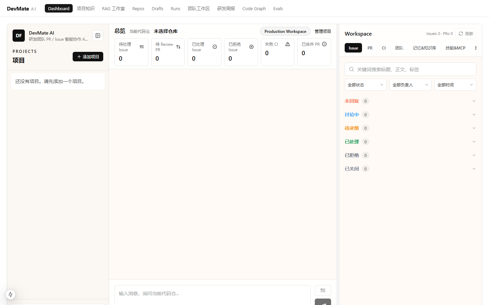
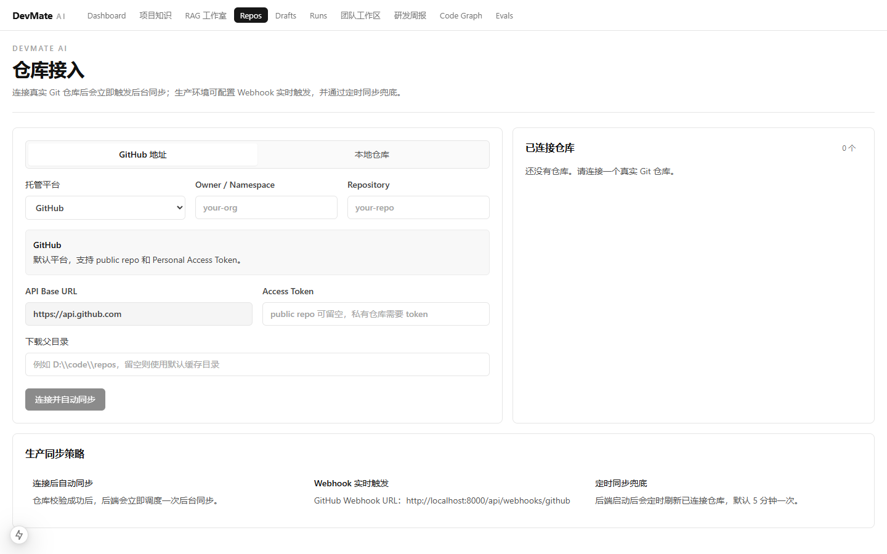
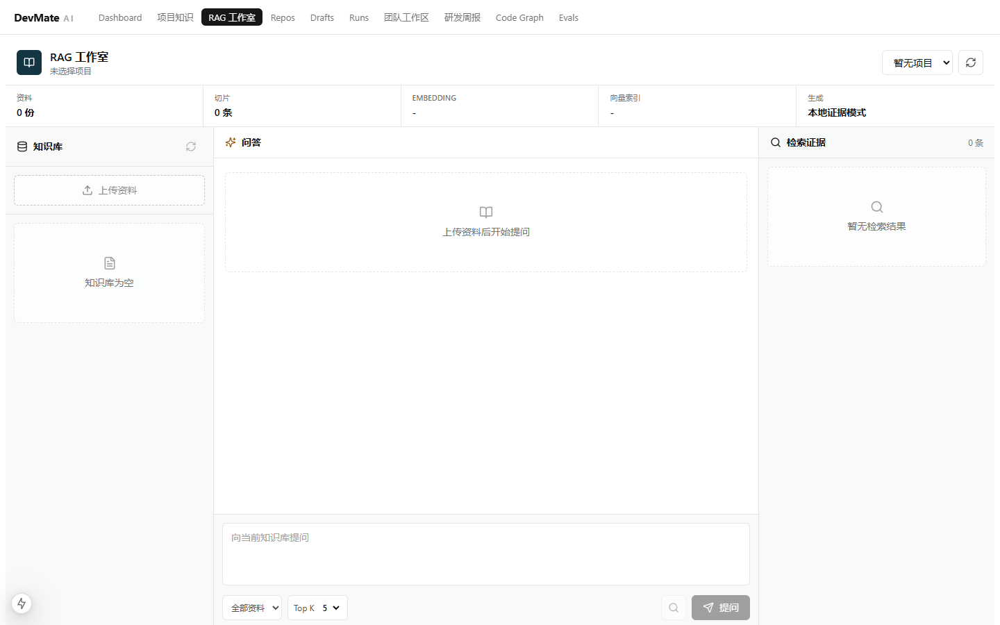
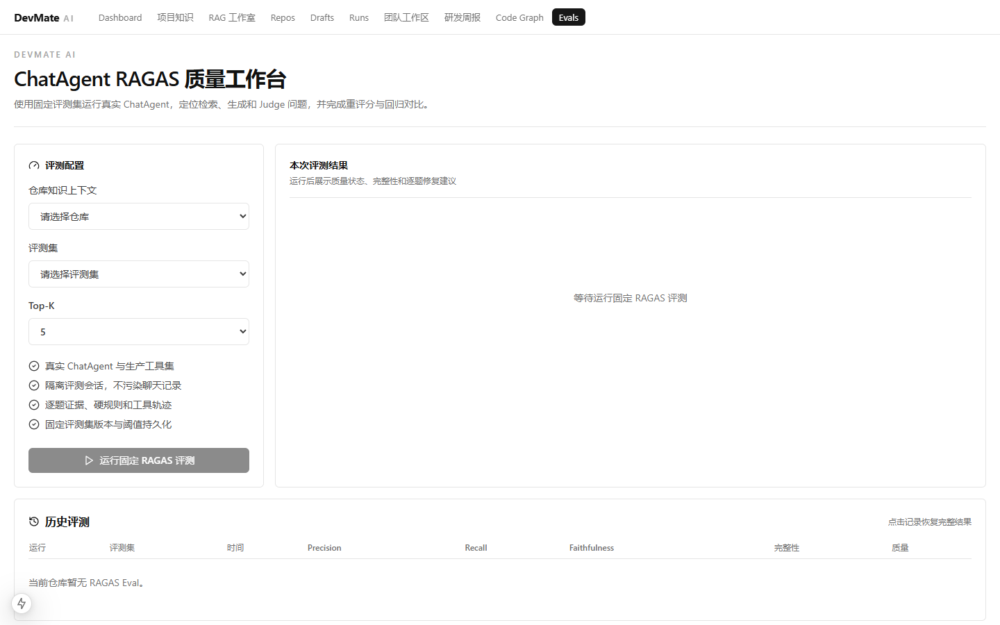
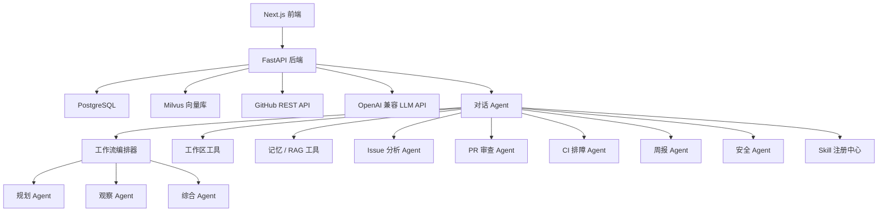

# DevMate AI

面向 GitHub PR / Issue 研发协作的全栈 AI Agent 平台。系统连接仓库数据，结合 Issue、PR diff、CI 日志、项目知识库与本地代码工作区，给出结构化分析与**可审计、需人工确认**的操作草稿。

## 界面预览

| 主工作台（Agent 对话 + Issue/PR/CI 面板） | 仓库接入与同步 |
|---|---|
|  |  |
| **RAG 知识问答工作室** | **ChatAgent RAGAS 评测** |
|  |  |

## 核心能力

- **仓库同步** — 全分页同步 Issue、Pull Request、PR 文件、Review 评论、Workflow Run、Job 与日志，同步状态细分到数据源级别
- **Issue 分析** — 分类、优先级、复杂度、推荐负责人、重复候选与行动项
- **PR 审查** — 摘要、关键变更、风险点、检查清单、测试建议与重点关注文件
- **CI 排障** — 失败类型识别、可能原因定位与排查步骤
- **Agent 对话** — `ChatAgent` 使用原生工具调用，串联工作区、记忆、RAG、Issue/PR/CI 专项 Agent 与安全工具，SSE 流式输出
- **多 Agent 工作流** — `WorkflowOrchestrator` 构建 Planner → 专用 Agent → Observer → Synthesis 闭环，处理跨领域的工程决策（PR 就绪度、阻塞项、优先级）
- **Skill Runtime** — 按显式指定或触发条件加载 `SKILL.md`，仅向当前任务暴露受限指令与工具白名单
- **RAG 知识问答** — 支持 TXT / Markdown / PDF / DOCX / JSON / CSV / 日志；段落感知切片、混合检索、重排、编号引用
- **记忆与知识管理** — 长期记忆审批、知识图谱、工作区安全检索
- **RAGAS 评测** — 五项语义指标 + 硬规则，支持基线回归对比与失败案例转 ActionDraft
- **安全动作草稿** — 所有对 GitHub 的写操作都经过「草稿 → 审计 → 人工确认」，绝不直接写入

## 技术栈

| 层 | 技术 |
|---|---|
| 后端 | Python、FastAPI、Pydantic、SQLAlchemy、PostgreSQL、Milvus、httpx、LangChain |
| Agent | 原生工具调用 + 专用分析 Agent + 工作流编排 |
| 前端 | Next.js 15（App Router）、TypeScript、Tailwind CSS |
| 基础设施 | Docker Compose、`.env` 配置 |

## 架构



## 目录结构

```
.
├── backend/
│   ├── app/
│   │   ├── api/routes/      # REST 路由（仓库、Issue、PR、CI、聊天、RAG、评测、记忆…）
│   │   ├── services/        # Agent、RAG、评测、同步、记忆等服务实现
│   │   ├── skills/          # SKILL.md 技能定义
│   │   ├── db/              # 数据模型与会话
│   │   └── tests/           # pytest 测试套件
│   └── requirements.txt
├── frontend/
│   ├── app/                 # Next.js 页面
│   ├── components/
│   │   └── workbench/       # 主工作台拆分后的功能模块
│   └── lib/                 # API 客户端与类型
├── docs/                    # 设计文档
├── scripts/                 # 辅助脚本
└── docker-compose.yml
```

## 快速开始

### 1. 启动基础设施

```bash
cp .env.example .env
docker compose up -d postgres etcd minio milvus
```

> `.env` 中至少需要填写 `LLM_API_KEY`（对话/工作流大模型）与 `EMBEDDING_API_KEY`（RAG 向量化）；`GITHUB_TOKEN` 用于仓库同步，不填则只能手动录入仓库。

### 2. 启动后端

```bash
cd backend
python -m venv .venv
.venv\Scripts\activate      # Windows；macOS/Linux 用 source .venv/bin/activate
pip install -r requirements.txt
uvicorn app.main:app --reload
```

### 3. 启动前端

```bash
cd frontend
npm install
npm run dev
```

访问 http://localhost:3000

## 关键配置

| 变量 | 说明 |
|---|---|
| `LLM_API_KEY` / `LLM_BASE_URL` / `LLM_MODEL` | 对话与工作流使用的大模型（OpenAI 兼容协议） |
| `EMBEDDING_API_KEY` / `EMBEDDING_MODEL` | RAG 向量化模型，默认百炼 `text-embedding-v4` |
| `GITHUB_TOKEN` | GitHub 仓库同步凭据 |
| `DATABASE_URL` | PostgreSQL 连接串 |
| `MILVUS_URI` / `MILVUS_COLLECTION` | Milvus 连接与向量集合 |
| `RAGAS_JUDGE_*` | 评测 Judge 模型（默认复用 `LLM_*`） |
| `AUTO_SYNC_LIMIT` | 定时同步每类记录上限（省略为全部分页） |

完整变量见 `.env.example`。

## 使用要点

**仓库同步**：手动同步默认读取全部分页，`limit` 控制每类记录上限；状态区分 `completed` / `empty` / `partial` / `failed` / `skipped`，响应中的 `sources` 与 `errors` 展示覆盖范围和失败原因。

**知识库**：知识需跨来源语义召回时进入 RAG；源码以当前 checkout 为准，走工作区检索；Issue/PR/CI 状态等结构化数据直接查库。RAG 结果是候选证据，实时状态仍需回到权威数据源核验。重建索引使用 `POST /api/rag/{repo_id}/reindex`。

**评测**：访问 `/evals` 选择仓库与评测集运行 RAGAS 评测，计算 Context Precision、Context Recall、Faithfulness、Answer Relevancy 与 Agent Goal Accuracy；支持基线回归对比，失败案例可一键生成 ActionDraft 进入人工确认流程。

## 开发

```bash
# 后端测试
cd backend && python -m pytest app/tests -q

# 前端构建
cd frontend && npm run build
```
